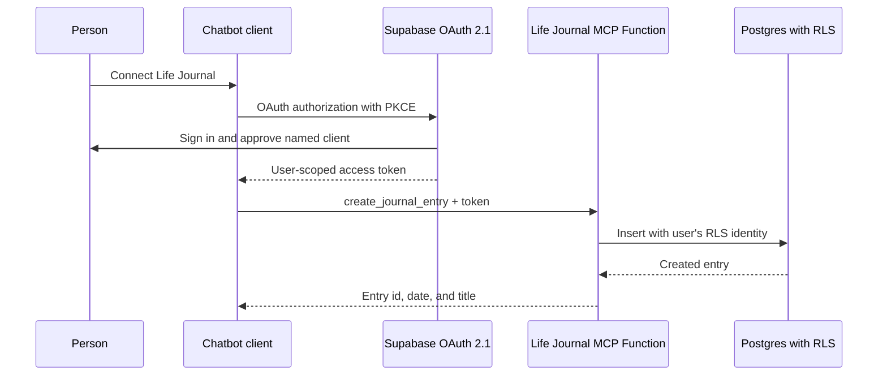

# Agent integration

## Purpose

Life Journal should let a person turn a conversation into a private record.
For example: “Put this into today's journal” or “Add this follow-up to my
plans.” The assistant must act only for the person who approved access, and it
must never receive a database secret or a shared service key.

## Product boundary

The first integration is a small set of explicit commands, not generic access
to every table or a natural-language database endpoint.

| Tool | Effect | Initial availability |
| --- | --- | --- |
| `create_journal_entry` | Creates one dated entry with a title and body | Yes |
| `create_action` | Creates one action with an optional due date | Yes |
| `list_open_actions` | Reads the caller's unarchived actions | Yes |
| `propose_actions` | Returns editable suggestions only | Later |
| `search_journal` | Searches the caller's entries | Later, after a clear retrieval experience exists |

Tools do not delete records in the first release. An AI suggestion does not
write an action or habit by itself. A chatbot must make a tool call only after
the person asked it to save the displayed content.

## Authentication and authorization

Use Supabase Auth's OAuth 2.1 server for MCP clients. The chatbot redirects
the person to Life Journal, where they sign in and approve the named client.
Supabase then issues a user token. The MCP Edge Function verifies that token
and executes each database operation with an RLS-scoped Supabase client.

This uses the existing account and `auth.uid()` ownership policies. It avoids
asking a person to paste a Supabase access token, a database password, or a
service-role key into a chatbot.

Before launch, enable OAuth 2.1 in the personal Supabase project, move JWT
signing to RS256 or ES256, and deploy the consent page at `/oauth/consent`.
Show the client name and requested access before approval. Enable dynamic client
registration for the personal MCP rollout so compatible chat clients can
connect; approval is still required before any client can read or write data.
Review registered clients regularly, and add a connected-client revocation
screen in **내 공간** before inviting other people to use the service.

Supabase's OAuth server is designed for this use case: its OAuth access tokens
carry the user identity and continue to enforce RLS. Its MCP middleware exposes
OAuth protected-resource metadata and supplies a user-scoped client to Edge
Function tools. See the [OAuth server guide](https://supabase.com/docs/guides/auth/oauth-server),
[MCP authentication guide](https://supabase.com/docs/guides/auth/oauth-server/mcp-authentication),
and [MCP Edge Function guide](https://supabase.com/docs/guides/ai-tools/byo-mcp).

## Runtime shape



## API contract

The MCP tools and a future HTTPS API share one command layer. Each write takes
an `idempotency_key` UUID generated by the client. Retrying the same request
returns the original result instead of creating a duplicate diary entry or
action.

Required fields are deliberately narrow:

```text
create_journal_entry(entry_date, title, body, idempotency_key)
create_action(title, due_date?, source_entry_id?, idempotency_key)
list_open_actions(limit?)
```

The server derives `user_id` from the OAuth token. It never accepts it from a
tool argument. For the first three tools, the idempotency key is also the UUID
of the new record, so a retry cannot create a second record. The initial MCP
server does not retain a chat transcript or a separate audit copy of journal
bodies.

## Delivery order

1. Enable OAuth 2.1, asymmetric JWT signing, and the deployed `mcp` function
   in the personal Supabase project.
2. Connect one personal chatbot client and test create, retry, wrong-user, and
   revoked-token paths.
3. Add connected-client visibility and revoke access in **내 공간**.
4. Publish HTTPS API documentation for developer integrations only after the
   MCP flow is verified.

No separate always-on backend is required. Supabase Edge Functions provide the
command and MCP runtime; the current Vercel PWA continues to host the user
interface and consent screen.
